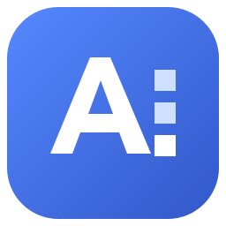

# anno+

anno+ is a Windows desktop visual study workspace for students and educators. Build a board from multiple images, text notes, shapes, arrows, freehand ink and highlights—then save the editable workspace or export it as a PNG.



## Features

- **Multi-image workspace:** add multiple images, or drag image files straight onto the canvas.
- **Arrange objects:** select and drag images, notes and annotations around the board.
- **Zoom:** use the zoom slider, the +/- controls, or Ctrl + mouse wheel.
- **Text notes:** add editable text with smooth Windows font rendering.
- **Annotation tools:** pen, highlighter, arrow, rectangle and ellipse, with colour and stroke-width controls.
- **Clipboard:** copy, cut, paste, duplicate and delete selected objects.
- **Undo:** remove the latest added/drawn object.
- **Projects:** save and reopen editable `.annoplus` workspaces.
- **Export:** render the workspace to a PNG.
- **Stock-image discovery:** open Unsplash education image results; download images and drag them into the workspace.
- **Branded Windows icon:** the build generates and embeds an app icon and uses it for the installer.

## Downloads

Every push to `main` builds two Windows x64 downloads:
- **`anno+-setup.exe`** — Windows installer.
- **`anno+-portable.exe`** — portable single-file executable; no installation step.

Both are self-contained .NET 8 Windows builds, so users do not need to install .NET separately. The app targets Windows 10/11 x64.

## Build

Open `AnnoPlus.sln` in Visual Studio 2022 with the .NET desktop development workload. Before building locally, generate the Windows icon in PowerShell:

```powershell
./scripts/generate-icon.ps1
dotnet publish src/AnnoPlus/AnnoPlus.csproj -c Release -r win-x64 --self-contained true
```

GitHub Actions builds the portable executable and installer automatically. Open the repository's **Actions** tab, select **Build Windows app and installer**, and download the `anno-plus-windows-x64` artifact after a successful run. Create a version tag such as `v0.2.0` to publish the same downloads as a GitHub Release.

## Notes

The current release is a canvas-style workspace, not a full PowerPoint replacement. PDF import, multi-page decks, resize handles, layers, autosave and direct in-app stock-image search/import are good candidates for future iterations. The stock-image button currently opens Unsplash in a browser; downloaded images can be dragged onto the canvas.
